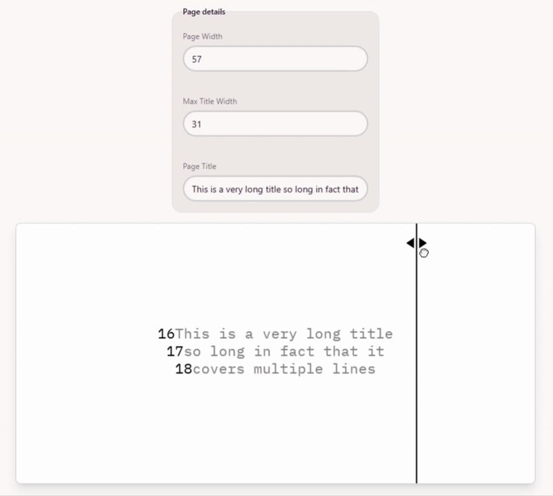
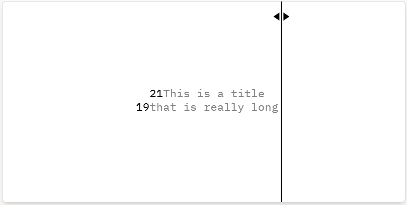

# A tool for centring titles on a typewriter

## The problem

I like to centre titles on a typewriter but it's often tricky, especially for longer titles. The method is this:

- Count the number of characters including spaces in the title
- Subtract from the number of characters on a line
- Divide by two
- Go to this position on the typewriter

This is fine and easy for short titles, but annoying when the title is long. What if it's long enough that you want to break it to multiple lines. Where do you break the text? What if you don't end up with a whole number of characters? Do you shift the title left or right? Is it possible to centre any title?

## The solution

See it [here](https://type.artomweb.com)


- The number at the beginning of each line is the number of spaces required to get to the first letter
- Numbers are red when the line requires a non-integer number of spaces, you can adjust the title width to find a solution with a whole number of spaces
- Each line is drawn where it will sit on the page; the faint vertical lines are the page edges
- To adjust the title width you can enter it at the top or drag the margin line (this works with touch too)
- If it is not possible to centre the title, "Cannot be centred" will appear under the text box. If a different max title width would work, it suggests the nearest one, and clicking the suggestion applies it
- The page details are saved to local storage so you don't have to input the page width each time

## Development

```
npm install
npm run dev    # start the dev server
npm test       # run the tests for the line-breaking algorithm
npm run build  # build for production
```

## Thinking

My approach is based on the [Knuth–Plass](https://en.wikipedia.org/wiki/Knuth%E2%80%93Plass_line-breaking_algorithm) algorithm used originally in TeX for justification in a visually appealing way.

So we want to centre a title, this is usually done with `(pageWidth - lineLength)/2` spaces before the first character. However, this could sometimes result in a non-integer number of characters and the typewriter can only move across in integer spaces. For that equation to be a whole number, both `pageWidth` and `lineLength` must have the same parity (both even or both odd). 

So for a given set of words, which splitting of the words looks visually balanced while satisfying the parity constraint. 

An alternative to the Knuth-Plass is a greedy algorithm where you pack as many words onto each line before the margin then spill to the next. This does not consider parity and it never goes back on itself to consider a better solution if it had put less words on a longer line.

### Knuth-Plass algorithm

The original Knuth-Plass algorithm for TeX is described in [Breaking Paragraphs into Lines (1981)](https://gwern.net/doc/design/typography/tex/1981-knuth.pdf). Knuth-Plass treats every position between words as a potential breakpoint. The word boundaries are numbered `0` to `N` where `0` is before the first word and `N` is after the last. Each node in the graph represents all the words placed up until that position. An edge from nodes `i` to `j` means put words `i` through `j-1` on one line.


#### The cost function

An edge only exists if placing those words on one line is feasible. In TeX this means that the line isn't too loose or tight (the spacing between the words is variable). For the typewriter, this could be both the margin width and the parity.

TeX's badness metric for a line is roughly `((idealWidth - actualWidth) / idealWidth)^3`. The equation is cubed so that one very bad line is penalised much more heavily than two moderately bad lines. This discourages the algorithm from making one line terrible to make others perfect. 

Each edge on the graph has this cost function. The total cost of a paragraph layout is the sum of the costs along the lines across the graph. Additional merit functions are added for things like two consecutive very loose lines or two hyphenated lines in a row.

Finding the layout with the minimal cost is therefore finding the shortest path from node `0` to node `N`. Because lines can only be broken, the edges on the graph only go one way, this means it is a solved problem with O(n^2) complexity where `n` is the number of words.

### Typewriter adaptation

My cost function is `(pageWidth - LineLength)^2`. Squaring is used as the inter-word gap is always the same so you can't get really bad looking lines as with TeX. The cost function still minimises the total wasted space with larger deviations penalised disproportionately.

A line of length L on a page of width W wastes W - L character positions (half on each side). Minimising Σ(W - Lᵢ)² is equivalent to minimising variance in line lengths, which is what you want visually, lines of similar length look more balanced than one long and one short.

In TeX, the badness score can get really really big, but in the typewriter problem, the criterion is a binary decision. If the line does not have the correct parity, the algorithm returns null as it really has infinite cost.

The title is never broken onto more lines than it needs (the number greedy wrapping gives). A short title like "Judith Kerr" on a 100 character page stays on one line half a space off-centre, with the space count shown in red, rather than being split into "Judith" / "Kerr" just to fix the parity. If a narrower title width would give an exactly centred split, it is offered as a suggestion.

## TODO

- Make the interface look like a type writer? At minimum a better form


